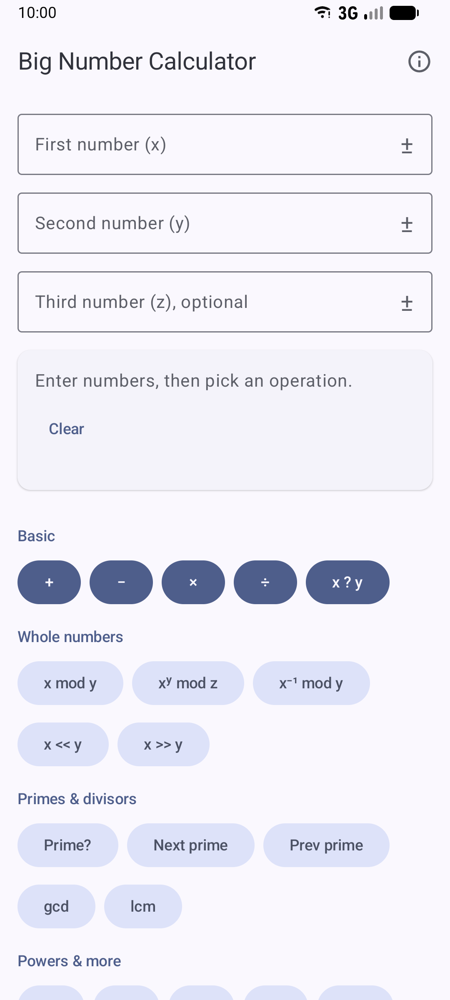
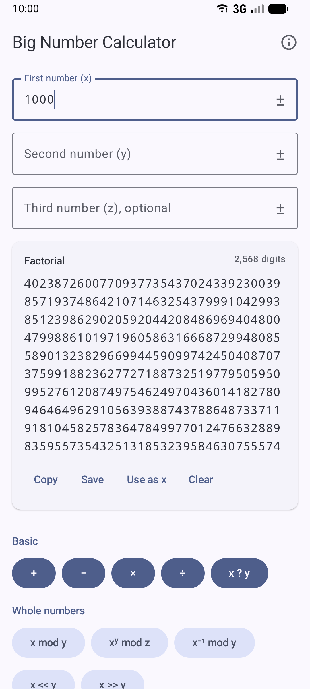
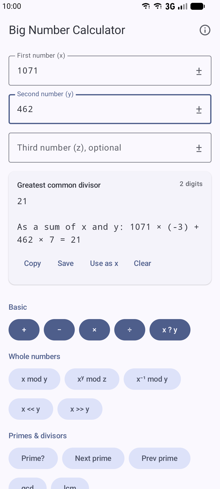
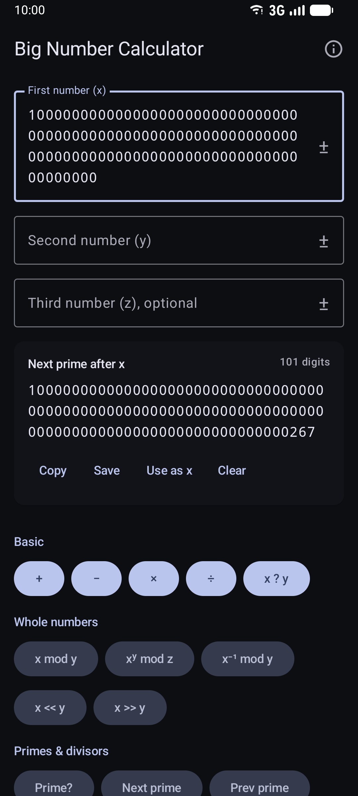

# Big Number Calculator

An Android calculator for numbers far too large for a normal calculator. It works with exact
integers and decimals of up to 10 million digits, such as 1,000,000! (5,565,709 digits), which
it computes in under half a second.

<p align="center">
  
  
  
  
</p>

## Features

| Group | Operations |
|---|---|
| Basic | Add, subtract, multiply, divide (100 decimal places), compare |
| Whole numbers | x mod y, xʸ mod z (modular power), modular inverse, left and right bit shifts |
| Primes & divisors | Primality test, next and previous prime, gcd (also shown as a sum of x and y, e.g. 1071 × (−3) + 462 × 7 = 21), lcm |
| Powers & more | xʸ (exact for whole exponents), x², x³, x!, natural logarithm |
| Counting & sequences | Combinations C(x, y), permutations P(x, y), Fibonacci and Catalan numbers |
| Bases & checks | Base 2–36 conversion, bit view with two's complement, check digits for card numbers and IMEIs, ISBN-10/13 and IBAN |

- **Exact results.** Whole-number powers, factorials and sequences are computed exactly. Results
  that can only be estimated, such as fractional powers and logarithms, start with "≈".
- **Results you can reuse.** Copy a result, save it as a `.txt` file of any size, or use it as the
  next x to chain calculations.
- **Runs in the background.** Long calculations show progress and can be cancelled, and the
  screen stays responsive.
- **Material 3 design.** On Android 12 and newer, the colors follow your wallpaper. Light and dark
  themes are both supported, and large screens get a two-pane layout.

## How it's built

- **App:** Kotlin and Jetpack Compose (`app/`). It supports Android 8.0 (API 26) and newer.
- **Math engine:** Rust, using the [malachite](https://www.malachite.rs/) arbitrary-precision
  library, called through JNI (`rust/`). It's built for arm64-v8a, armeabi-v7a and x86_64.

## Building

You need JDK 21, the Android SDK with NDK `30.0.16248370`, and Rust:

```bash
rustup target add aarch64-linux-android armv7-linux-androideabi x86_64-linux-android
cargo install cargo-ndk
```

Then build as usual. Gradle runs `cargo ndk` for the Android libraries:

```bash
./gradlew assembleDebug
```

Unit tests run against a host build of the same Rust library:

```bash
./gradlew testDebugUnitTest
```

## Releases

Pushing a tag builds signed APKs, one per CPU type, and attaches them to a GitHub release named
after the tag. Plain commits build nothing. The app's version name comes from the tag, with any
leading `v` removed.

```bash
git tag v2.1.0
git push origin v2.1.0
```

If a release for the tag already exists, for example one created in the GitHub web page, the APKs
are attached to it.

Without signing secrets, the workflow signs with a key generated for that run. Those APKs install
fine, but each release then has a different key, so a newer one won't install over an older one
without uninstalling first. To sign every release with your own key, add these repository secrets
under Settings → Secrets and variables → Actions:

| Secret | Value |
|---|---|
| `SIGNING_KEYSTORE_BASE64` | Your `.jks` keystore, base64-encoded: `base64 -w0 release.jks` |
| `SIGNING_STORE_PASSWORD` | Keystore password |
| `SIGNING_KEY_ALIAS` | Key alias |
| `SIGNING_KEY_PASSWORD` | Key password |

Use the same key the Play Store version was signed with, so the APKs install as updates over it.
`versionCode` is still set by hand in `app/build.gradle.kts`, so raise it for each release.

## License

GPL-3.0. malachite is LGPL-3.0.
